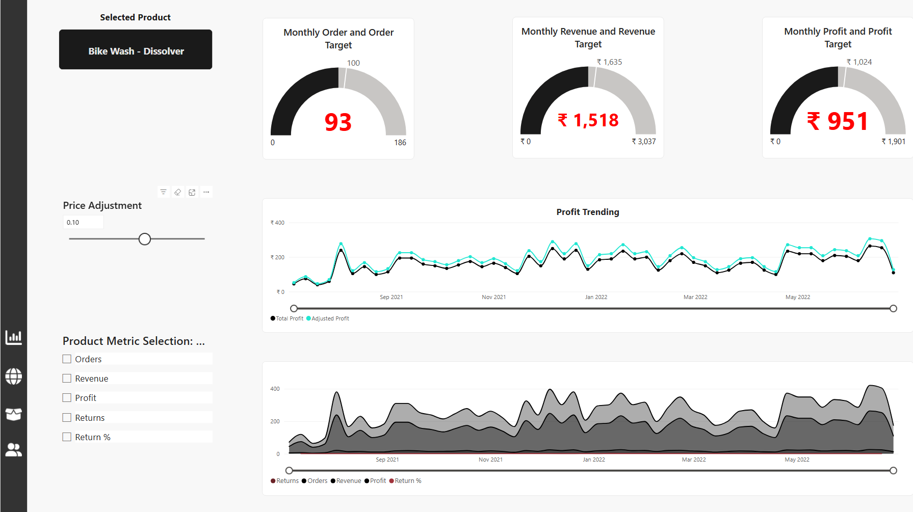

# Sales & Business Performance Analytics | Power BI

## Project Overview

An end-to-end business intelligence project using the AdventureWorks dataset to analyze sales performance, geographical trends, customer insights and product performance.

The project focuses on transforming raw business data into meaningful insights to support data-driven decision-making.

## Business Objectives

- Monitor overall business performance and KPIs.
- Analyze sales trends across geographical regions.
- Understand customer purchasing patterns.
- Evaluate product-level performance.
- Support financial and strategic decision-making.

## Dashboard Preview

### 1. Executive Dashboard

Provides an overview of business performance, key metrics and sales trends.

### 2. Geographical Analysis

Visualizes regional sales performance and geographical distribution.

### 3. Customer Details

Provides customer-level insights and purchasing behavior analysis.

### 4. Product Details

Evaluates product performance and supports product-level business analysis.

## Tools & Skills

- Microsoft Power BI
- Business Intelligence
- Data Analysis
- Data Visualization
- KPI Reporting
- Sales Performance Analysis
- Financial and Business Analytics

## Business Applications

- Management Reporting
- Financial Performance Monitoring
- Sales Strategy
- Customer Analysis
- Product Performance Evaluation

## Dataset

AdventureWorks sample dataset.

## About Me

BBA Finance graduate with an interest in financial analysis, accounting, business intelligence and data-driven decision-making.

This project showcases my ability to combine business knowledge with analytical tools to deliver meaningful business insights.
