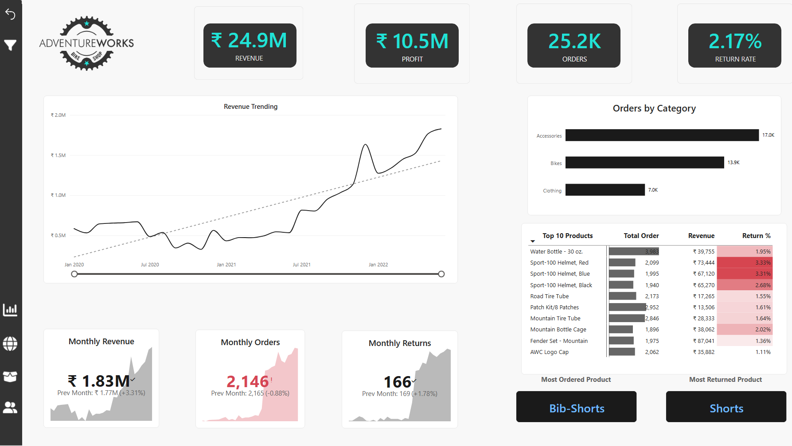
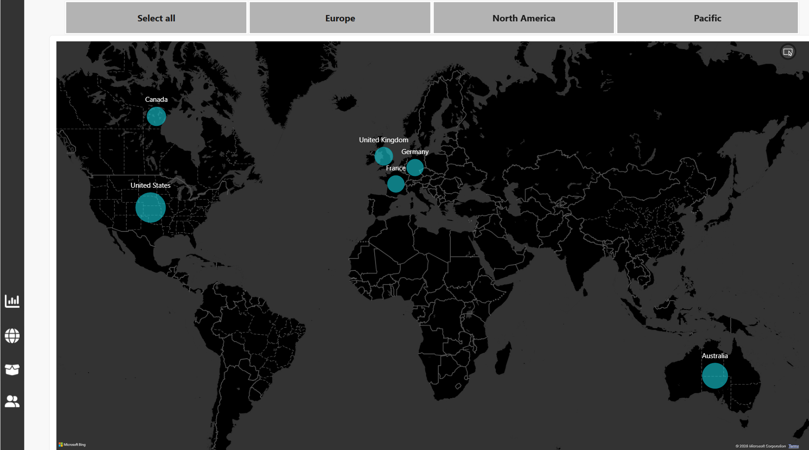
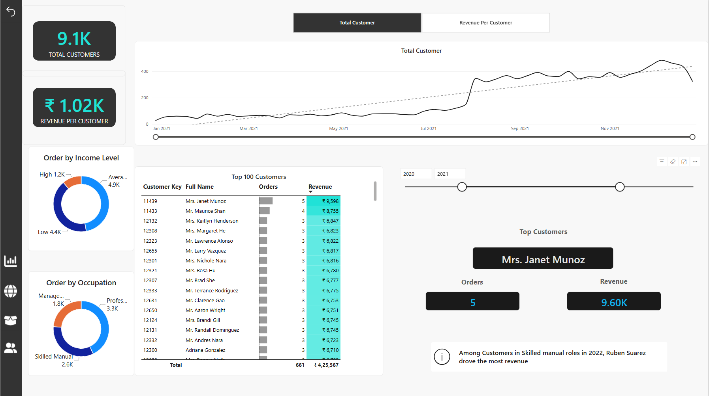

# Sales & Business Performance Analytics | Power BI

## Project Overview

An end-to-end business intelligence project using the AdventureWorks dataset to analyze sales performance, geographical trends, customer insights and product performance.

The project focuses on transforming raw business data into meaningful insights to support data-driven decision-making.

## Business Objectives

- Monitor overall business performance and KPIs.
- Analyze sales trends across geographical regions.
- Understand customer purchasing patterns.
- Evaluate product-level performance.
- Support financial and strategic decision-making.

## Dashboard Preview

### 1. Executive Dashboard

Provides an overview of business performance, key metrics and sales trends.

### 2. Geographical Analysis

Visualizes regional sales performance and geographical distribution.

### 3. Customer Details

Provides customer-level insights and purchasing behavior analysis.

### 4. Product Details

Evaluates product performance and supports product-level business analysis.

## Key Business & Financial Insights

- Analyzed total revenue of 24.9 million and total profit of 10.5 million.
- Calculated an approximate profit margin of 42.2%, providing insights into overall business profitability.
- Evaluated approximately 25,200 orders across multiple product categories and geographical regions.
- Identified an overall product return rate of 2.17%.
- Analyzed monthly revenue of 1.83 million to monitor business performance.
- Identified Bib-Shorts as the most ordered product type and Shorts as the most returned product type.
- Observed an overall upward revenue trend across the reporting period.

## Business Recommendations

- Investigate products with higher return rates to identify potential quality or customer satisfaction issues.
- Prioritize high-performing products and profitable customer segments.
- Monitor revenue growth, profit margins and monthly performance to support financial planning.
- Evaluate regional performance to identify potential market expansion opportunities.

## Tools & Skills

- Microsoft Power BI
- Business Intelligence
- Data Analysis
- Data Visualization
- KPI Reporting
- Sales Performance Analysis
- Financial and Business Analytics

## Business Applications

- Management Reporting
- Financial Performance Monitoring
- Sales Strategy
- Customer Analysis
- Product Performance Evaluation

## Dataset

AdventureWorks sample dataset.

## About Me

BBA Finance graduate with an interest in financial analysis, accounting, business intelligence and data-driven decision-making.

This project showcases my ability to combine business knowledge with analytical tools to deliver meaningful business insights.
